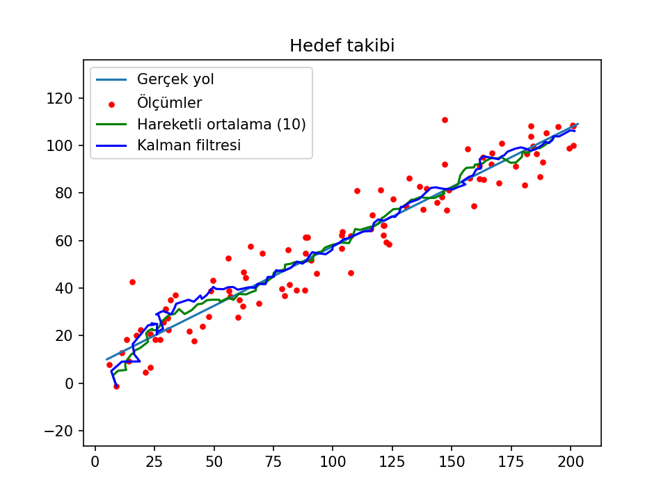
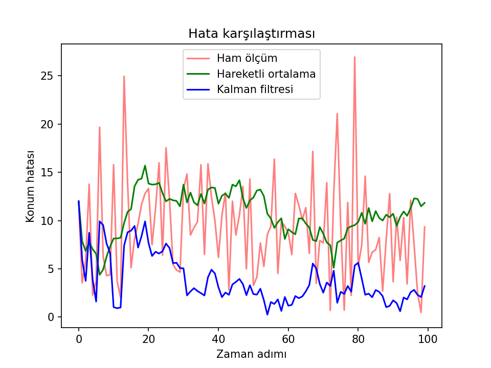

# Hedef Takip Simülasyonu

Gürültülü sensör (radar) ölçümlerinden hareket eden bir hedefin konumunu tahmin eden küçük bir Python projesi. Aynı veri üzerinde üç yöntemi karşılaştırıyorum: ham ölçüm, hareketli ortalama ve Kalman filtresi.

Amacım Kalman filtresinin neden kullanıldığını sadece okuyarak değil, kendim kodlayıp sayılarla görerek anlamaktı. Konu, radar ve sensör tabanlı takip sistemlerinin temel problemine dayanıyor.

## Problem

Sensörler gerçek konumu değil, gerçek konum + rastgele hata değerini verir. Hedef hareket ettiği için tek bir ölçüme güvenmek yanıltıcıdır. Soru şu: bu gürültülü ölçümlerden gerçek konuma en yakın tahmini nasıl üretiriz?

## Yöntemler

**1. Ham ölçüm.** Sensörün verdiği değere olduğu gibi güveniyoruz. Referans noktası olarak kullanılıyor.

**2. Hareketli ortalama.** Her noktayı son 10 ölçümün ortalamasıyla değiştiriyoruz. Rastgele gürültü ortalamada birbirini götürdüğü için çizgi düzleşiyor. Ancak sadece geçmişe baktığı için hedef ilerlerken tahmin geride kalıyor.

**3. Kalman filtresi.** Sabit hız modelli, 2 boyutlu. Durum vektörü `[x, y, vx, vy]`, yani konumla birlikte hızı da tahmin ediyor. Her adımda iki işlem yapıyor:

- **Tahmin:** "Hedef bu hızla gidiyordu, şimdi şurada olmalı."
- **Düzeltme:** Yeni ölçüm gelince tahmin ile ölçüm arasında, ikisinin belirsizliğine göre bir ağırlıkla karar veriyor (Kalman kazancı).

Hızı bildiği için hedefin ilerleyişini önceden hesaba katıyor ve gecikme yapmıyor.

## Sonuçlar

Simülasyon parametreleri: 100 adım, ölçüm gürültüsü standart sapması 8, sabit hız, `seed=42`.

| Yöntem | RMSE (küçük = iyi) |
|---|---|
| Ham ölçüm | 10.52 |
| Hareketli ortalama (pencere 10) | 10.88 |
| Kalman filtresi | 4.62 |

Kalman filtresi ham ölçüme göre hatayı yaklaşık %56 azaltıyor.




## Çıkarımlar

- **Hareketli ortalama, ham ölçümden daha kötü çıktı.** İlk bakışta şaşırtıcı, ama sebebi gecikme: 10'luk pencerenin ortalama gecikmesi yaklaşık 4,5 adım, hedef adım başına yaklaşık 2,24 birim gittiği için çizgi gerçek konumun yaklaşık 10 birim gerisinde kalıyor. Gürültüyü azaltmanın kazancı, bu sabit sapmanın maliyetini karşılamıyor. Hata grafiğinde yeşil çizginin zamanla düşmeyip yüksek kalmasının sebebi bu.
- **Pencereyi büyütmek çözüm değil.** Düzgünlük artıyor ama gecikme de aynı oranda artıyor. Bu bir ödünleşim.
- **Kalman'ın ilk adımlardaki hatası büyük.** Başta hızı bilmiyor ve başlangıç belirsizliği (`P`) bilerek yüksek verilmiş. Birkaç ölçümden sonra hızı öğreniyor ve hata belirgin şekilde düşüyor.
- **Kalman filtresinde asıl ayar `Q` ve `R`.** `R` sensörün ne kadar güvenilmez olduğunu, `Q` modele ne kadar güvendiğimizi belirler. `Q` büyütülürse filtre ölçümlere daha çok uyar ve çizgi titrer, küçültülürse daha pürüzsüz ama değişikliklere yavaş tepki verir.

## Sınırlamalar

- Hedef sabit hızla düz gidiyor. Manevra yapan hedefler için bu model yetersiz kalır (ivmeli model veya Genişletilmiş Kalman Filtresi gerekir).
- Gürültünün standart sapması filtreye biliniyormuş gibi veriliyor. Gerçek sistemlerde bu değer ölçülmeli veya tahmin edilmeli.
- Veri simüle, gerçek sensör verisi değil.

## Çalıştırma

```
pip install numpy matplotlib
python takip.py
```

Terminalde üç RMSE değeri yazdırılır, iki grafik açılır ve `yol.png`, `hata.png` olarak kaydedilir.

## Kullanılan teknolojiler

Python, NumPy, Matplotlib

## Sonraki adımlar

- Manevra yapan hedef için ivmeli model
- Farklı gürültü seviyelerinde ve `Q` değerlerinde sistematik karşılaştırma
- C++ ile aynı filtrenin yeniden yazılması
